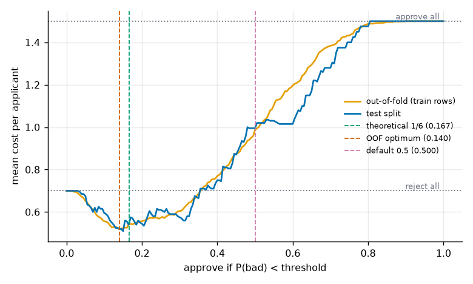
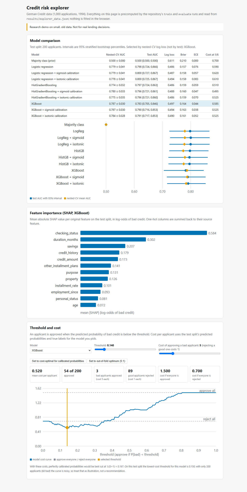
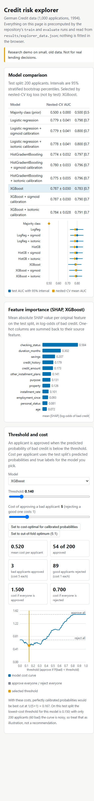
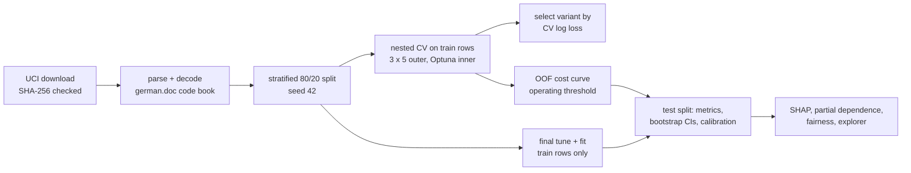
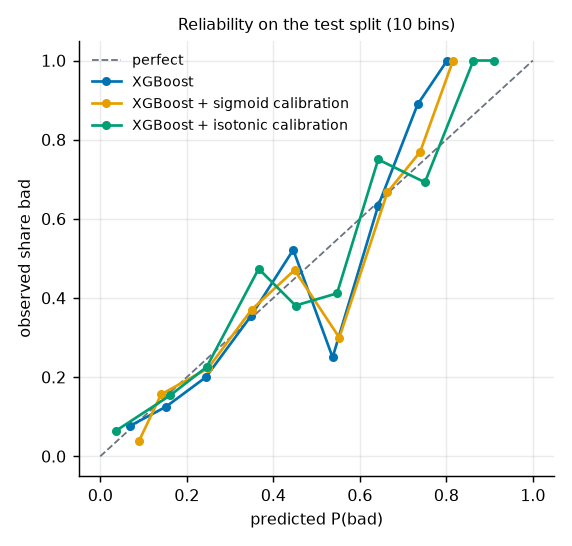
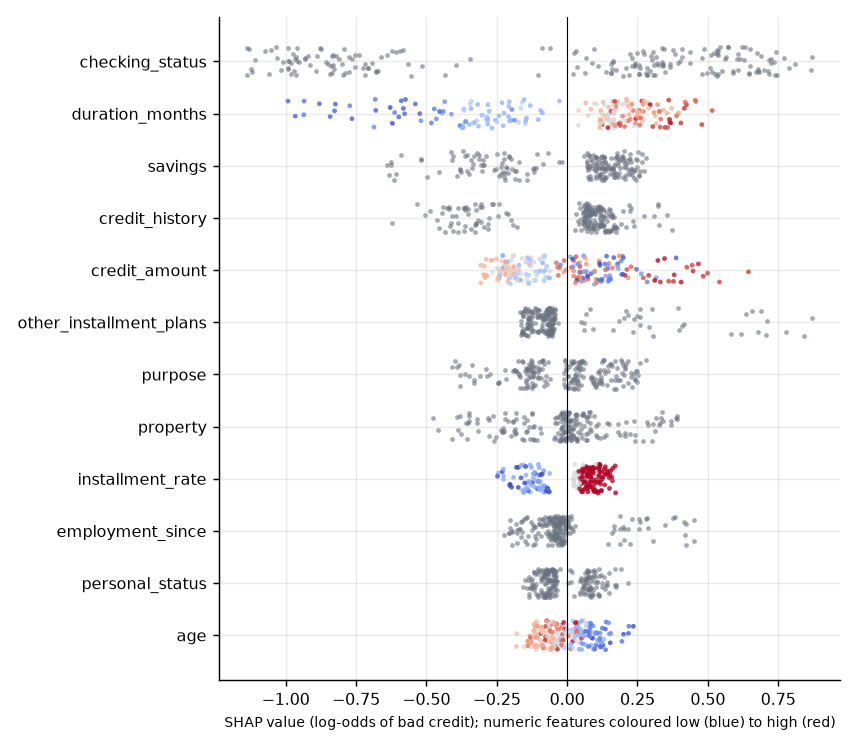
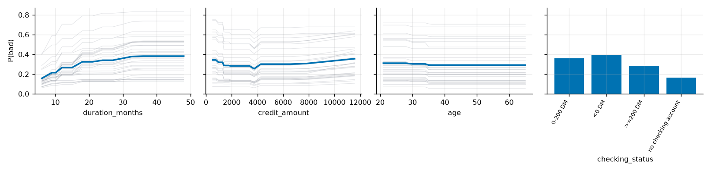
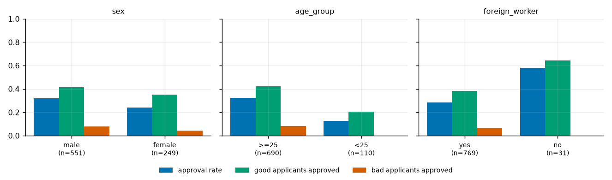

# Loan credit-risk prediction: calibrated, cost-sensitive tabular ML on the German Credit data

[](https://creativecommons.org/licenses/by-nc-nd/4.0/)
[](.github/workflows/ci.yml)

## Summary

| | |
|---|---|
| **Question** | Can gradient boosting beat a well-preprocessed logistic regression at predicting bad credit on a small, public credit set, and how should the probabilities be turned into approve/reject decisions when a false approval costs 5 times a false rejection? |
| **Data** | Statlog German Credit (1,000 applications, 20 attributes, 30% bad), UCI, CC BY 4.0, downloaded at run time with a pinned SHA-256 |
| **Protocol** | Stratified 800/200 train/test split (seed 42). Nested CV on the 800 training rows (3 repeats x 5 outer folds; Optuna with 20 trials on 3 inner folds). The model is picked by nested-CV log loss, never by the test split. 2,000-resample bootstrap intervals on the test split. |
| **Discrimination** | Test AUC: logistic regression 0.798, HistGradientBoosting 0.797, XGBoost 0.783, majority class 0.500. **No model beats logistic regression reliably**: every paired AUC difference has an interval that contains 0. |
| **Calibration** | Test ECE is between 0.04 and 0.08 for every non-baseline model. Sigmoid calibration helps a little (intervals overlap); isotonic calibration does not help at n = 800. |
| **Decision cost** | With the cost matrix, the chosen XGBoost model approves when P(bad) < 0.14 and costs 0.520 [0.435, 0.630] per applicant on the test split, against 0.700 for rejecting everyone, 1.500 for approving everyone and 0.995 at the default 0.5 threshold. |
| **Fairness** | Out-of-fold, the model approves applicants under 25 far less often than older ones (gap -0.196 in approval rate, 95% interval [-0.266, -0.121]), and dropping the `age` column (with `personal_status` and `foreign_worker`) narrows it only partly. Group sizes are small; see the caveats below. |
| **Leakage checks** | Pipelines are fitted inside each training fold (tested). Running the whole nested procedure on permuted labels gives AUC 0.466 (logistic regression) and 0.479 (HistGradientBoosting). |
| **Explorer** | `docs/index.html`: model comparison, SHAP importance and a threshold/cost slider, all precomputed |

**Not for real lending decisions.** This is a methodology study on 1,000 records from 1994.



## Overview

A credit decision is a cost decision: approving a borrower who defaults is much worse than turning away one who would have repaid. This repository builds the full chain on a small public set, with the checks that usually get skipped: preprocessing that cannot leak, tuning inside the cross-validation, probability calibration, a decision threshold derived from an explicit cost matrix, explanations, and a look at how the decisions differ across groups.

## Demo

Open `docs/index.html` in a browser (no server needed). It shows the model comparison table with bootstrap intervals, SHAP importance, and a threshold and cost slider that recomputes the confusion counts and mean cost from the stored test-split probabilities. Checked with Playwright at 390 px and 1280 px with no console errors.

| 1280 px | 390 px |
|---|---|
|  |  |

## Problem statement

Predict `bad` (1 = bad credit risk) from 20 applicant and loan attributes, then choose approve/reject to minimise expected cost. The cost matrix is the one published with the dataset: approving an applicant who turns out bad costs 5, rejecting an applicant who would have repaid costs 1, correct decisions cost 0. For a calibrated probability p of "bad", approving is cheaper when 5p < 1 - p, that is when p < 1/6.

## Approach



- **Models:** majority class (prior); logistic regression (one-hot, median imputation, log of credit amount, standardisation); HistGradientBoosting (native categorical support); XGBoost (one-hot). All preprocessing lives inside a scikit-learn `Pipeline`, so it is fitted on training rows only, in every fold and in every calibration split.
- **Tuning:** Optuna TPE sampler, seeded per fold, minimising mean inner-CV log loss. Search spaces are in `src/credit_risk/models.py`.
- **Calibration:** none, Platt (sigmoid) or isotonic, each fitted with 5 internal folds on the training part only.
- **Threshold:** the operating threshold is the minimiser of cost on the out-of-fold probabilities of the training rows (all repeats pooled). The theoretical threshold 1/6 is reported next to it.
- **Explanations:** SHAP (TreeExplainer on the XGBoost model, summed over one-hot columns) and manual partial dependence on the HistGradientBoosting model.
- **Fairness:** group approval and error rates for sex, age under 25, and foreign worker, with bootstrap intervals on the gaps, on pooled out-of-fold predictions (n = 800) and on the test split (n = 200).

## Data

- **Source:** Hofmann, H. (1994). Statlog (German Credit Data). UCI Machine Learning Repository. https://doi.org/10.24432/C5NC77
- **License:** CC BY 4.0 (stated on the UCI page). See `THIRD_PARTY_NOTICES.md`.
- **Size:** 1,000 applications, 700 good and 300 bad; 7 numeric and 13 categorical attributes.
- **Download:** `credit-risk train` fetches `statlog+german+credit+data.zip` and refuses to continue unless its SHA-256 equals `e12d9d5def6845c0622634a1cd2ab87fa470668c4298f1ec52a4e403376a435b`. Nothing is committed except small derived results.
- **Splits:** stratified 800 train / 200 test (seed 42), 30% bad in both.
- **Sensitive attributes:** the file combines marital status and sex in `personal_status`; `sex` is derived from it. `age_group` splits at 25. `foreign_worker` is an original attribute. These are used for the fairness check; the main models are trained with all 20 attributes, and an ablation drops `personal_status`, `age` and `foreign_worker`.
- **Privacy:** records are anonymous and from 1994; no personal data is used or stored.

## Results

All numbers come from `docs/runs/2026-10-15-main-run.md` (seed 42, run on 2026-10-15) and `results/*.json`.

### Test split, 200 applicants (95% bootstrap intervals)

| Model | AUC | PR-AUC | log loss | Brier | ECE | cost at 1/6 |
|---|---|---|---|---|---|---|
| Majority class (prior) | 0.500 [0.500, 0.500] | 0.300 [0.300, 0.300] | 0.611 | 0.210 | 0.000 | 0.700 |
| Logistic regression | 0.798 [0.724, 0.866] | 0.653 [0.546, 0.765] | 0.486 | 0.157 | 0.076 | 0.590 |
| Logistic regression + sigmoid calibration | 0.800 [0.727, 0.867] | 0.656 [0.549, 0.768] | 0.487 | 0.158 | 0.057 | 0.620 |
| Logistic regression + isotonic calibration | 0.800 [0.725, 0.867] | 0.659 [0.550, 0.770] | 0.494 | 0.158 | 0.083 | 0.610 |
| HistGradientBoosting | 0.797 [0.724, 0.863] | 0.657 [0.553, 0.763] | 0.486 | 0.159 | 0.059 | 0.510 |
| HistGradientBoosting + sigmoid calibration | 0.796 [0.721, 0.861] | 0.650 [0.544, 0.754] | 0.488 | 0.160 | 0.047 | 0.495 |
| HistGradientBoosting + isotonic calibration | 0.796 [0.721, 0.860] | 0.664 [0.560, 0.763] | 0.486 | 0.159 | 0.070 | 0.525 |
| XGBoost | 0.783 [0.705, 0.846] | 0.639 [0.539, 0.739] | 0.497 | 0.164 | 0.044 | 0.585 |
| XGBoost + sigmoid calibration | 0.790 [0.716, 0.853] | 0.652 [0.549, 0.750] | 0.494 | 0.163 | 0.038 | 0.525 |
| XGBoost + isotonic calibration | 0.791 [0.717, 0.853] | 0.659 [0.556, 0.756] | 0.490 | 0.161 | 0.052 | 0.525 |

Cost is the mean cost per applicant at the theoretical threshold 1/6 (a false approval counts 5, a false rejection 1). The best possible trivial policy, rejecting everyone, costs 0.700.

### Nested cross-validation (800 training rows, mean +/- sd over 15 outer folds)

| Model | AUC | log loss | Brier | ECE | cost at 1/6 |
|---|---|---|---|---|---|
| Majority class (prior) | 0.500 +/- 0.000 | 0.611 | 0.210 | 0.000 | 0.700 |
| Logistic regression | 0.779 +/- 0.041 | 0.504 | 0.168 | 0.070 | 0.537 |
| Logistic regression + sigmoid calibration | 0.779 +/- 0.041 | 0.504 | 0.168 | 0.068 | 0.529 |
| Logistic regression + isotonic calibration | 0.778 +/- 0.041 | 0.525 | 0.171 | 0.077 | 0.537 |
| HistGradientBoosting | 0.774 +/- 0.032 | 0.515 | 0.171 | 0.074 | 0.568 |
| HistGradientBoosting + sigmoid calibration | 0.780 +/- 0.033 | 0.508 | 0.169 | 0.072 | 0.547 |
| HistGradientBoosting + isotonic calibration | 0.775 +/- 0.035 | 0.538 | 0.171 | 0.077 | 0.560 |
| XGBoost | 0.787 +/- 0.030 | 0.501 | 0.167 | 0.071 | 0.542 |
| XGBoost + sigmoid calibration | 0.787 +/- 0.030 | 0.504 | 0.167 | 0.072 | 0.532 |
| XGBoost + isotonic calibration | 0.784 +/- 0.028 | 0.579 | 0.167 | 0.078 | 0.537 |

Selection rule, fixed in advance: lowest mean nested-CV log loss. It picked `XGBoost` (uncalibrated). The folds of a repeated CV are not independent, so the sd describes spread, not a confidence interval.

### Paired AUC differences on the test split

- xgb minus logreg: -0.015 [-0.055, +0.024]
- hgb minus logreg: -0.001 [-0.034, +0.031]
- xgb minus hgb: -0.015 [-0.039, +0.010]

### Cost-sensitive threshold

- Theoretical threshold for calibrated probabilities: 1/6 = 0.1667.
- Threshold that minimises cost on the out-of-fold training predictions: 0.140 (the operating threshold).
- Test cost per applicant at the operating threshold: 0.520 [0.435, 0.630]; at 1/6: 0.585 [0.460, 0.735]; at 0.5: 0.995 [0.805, 1.180].
- Trivial policies on the test split: approve everyone 1.500, reject everyone 0.700.
- Operating policy minus reject-everyone, paired bootstrap: -0.180 [-0.265, -0.070]; minus approve-everyone: -0.980 [-1.065, -0.870].
- The cost curve is flat between about 0.10 and 0.30, so the threshold is not sharply determined; the default 0.5 is clearly worse.



Isotonic calibration needs more data than 800 rows give it: its log loss is worse than the raw model's in nested CV. Sigmoid calibration changes little. The ECE intervals are percentile bootstrap intervals; ECE is biased upward on small samples, so an interval can sit above its point estimate.

### Explanations



`checking_status`, `duration_months`, `savings`, `credit_history` and `credit_amount` carry the most SHAP weight; longer loans and larger amounts raise predicted risk. Partial dependence of the HistGradientBoosting model:



### Fairness check

Operating threshold 0.140, model `xgb|raw`. Pooled out-of-fold predictions on the 800 training rows; every row is scored by models that never saw it.

**sex** (gaps are female minus male, 95% bootstrap intervals)

| group | n | bad rate | approval rate | good applicants approved | bad applicants approved | AUC |
|---|---|---|---|---|---|---|
| male | 551 | 0.274 | 0.321 | 0.412 | 0.079 | 0.797 |
| female | 249 | 0.357 | 0.241 | 0.350 | 0.045 | 0.767 |

Gaps: approval rate -0.080 [-0.146, -0.011]; approve good rate -0.062 [-0.152, +0.025]; approve bad rate -0.035 [-0.094, +0.027]

**age_group** (gaps are <25 minus >=25, 95% bootstrap intervals)

| group | n | bad rate | approval rate | good applicants approved | bad applicants approved | AUC |
|---|---|---|---|---|---|---|
| >=25 | 690 | 0.287 | 0.323 | 0.421 | 0.081 | 0.801 |
| <25 | 110 | 0.382 | 0.127 | 0.206 | 0.000 | 0.697 |

Gaps: approval rate -0.196 [-0.266, -0.121]; approve good rate -0.215 [-0.316, -0.105]; approve bad rate -0.081 [-0.120, -0.045]

**foreign_worker** (gaps are no minus yes, 95% bootstrap intervals)

| group | n | bad rate | approval rate | good applicants approved | bad applicants approved | AUC |
|---|---|---|---|---|---|---|
| yes | 769 | 0.308 | 0.285 | 0.382 | 0.068 | 0.787 |
| no | 31 | 0.097 | 0.581 | 0.643 | 0.000 | 0.821 |

Gaps: approval rate +0.296 [+0.118, +0.477]; approve good rate +0.261 [+0.072, +0.433]; approve bad rate -0.068 [-0.101, -0.038]

The test split gives the same direction with much wider intervals (see `docs/runs/`).



What this does and does not show:

- Dropping `personal_status`, `age` and `foreign_worker` leaves AUC unchanged (0.783 with, 0.787 without) but the age gap in approval rate only narrows (-0.144 [-0.222, -0.059] against -0.196 with all features), which suggests that other columns carry information about age (likely proxies; this was not tested further).
- Equal approval rates, equal rates among good applicants, and equal rates among bad applicants cannot all hold when base rates differ, so there is no single "fair" threshold to report.
- Groups are small: 110 applicants under 25 and 31 non-foreign workers in the training rows; 6 non-foreign workers in the test split. Intervals are wide and the foreign-worker numbers should not be read as a finding.
- The labels record 1994 lending outcomes, which include the lenders' own decisions; a model that matches them can reproduce their bias. Equal treatment of sex and age is also a legal matter that a metric table cannot settle.

### Seed sweep

Tuning and evaluation repeated for hold-out seeds [0, 1, 2, 3, 4] (20 trials per model); mean (sd) over seeds on each seed's own 200-row test split.

| Model | calibration | AUC | log loss | Brier | ECE | cost at 1/6 |
|---|---|---|---|---|---|---|
| hgb | raw | 0.791 (0.024) | 0.494 (0.020) | 0.164 | 0.054 | 0.534 (0.054) |
| hgb | sigmoid | 0.801 (0.026) | 0.486 (0.019) | 0.160 | 0.053 | 0.522 (0.051) |
| logreg | raw | 0.791 (0.021) | 0.492 (0.016) | 0.163 | 0.067 | 0.532 (0.031) |
| logreg | sigmoid | 0.792 (0.022) | 0.493 (0.016) | 0.163 | 0.059 | 0.531 (0.036) |
| majority | raw | 0.500 (0.000) | 0.611 (0.000) | 0.210 | 0.000 | 0.700 (0.000) |
| xgb | raw | 0.797 (0.023) | 0.486 (0.023) | 0.161 | 0.060 | 0.524 (0.032) |
| xgb | sigmoid | 0.800 (0.024) | 0.490 (0.020) | 0.161 | 0.066 | 0.538 (0.041) |

See `docs/runs/` for the dated log.

## Tech stack

Python 3.11, scikit-learn 1.9, XGBoost 3.2, Optuna 5.0, SHAP 0.51, pandas 3.0, matplotlib, pytest, ruff. Exact versions are pinned in `requirements.txt`.

## Getting started

Prerequisites: Python 3.11 and git. No GPU.

```bash
git clone https://github.com/Janeferdinant/loan-credit-risk-prediction.git
cd loan-credit-risk-prediction
python -m venv .venv && source .venv/bin/activate      # Windows: .venv\Scripts\activate
python -m pip install -r requirements.txt
python -m pip install -e .

python -m pytest -m "not slow"                         # fast tests (about 1 minute)
credit-risk train --jobs 8                             # downloads the data, runs nested CV and final fits (about 3 minutes on 16 CPUs)
credit-risk evaluate --jobs 8                          # test metrics, thresholds, fairness, SHAP, figures, run log (about 4 minutes)
python scripts/build_explorer.py                       # writes docs/index.html
credit-risk sweep --jobs 8                             # optional: repeat everything for seeds 0-4
```

Quick smoke setting (about 1 minute, rough numbers): `credit-risk train --trials 3 --splits 3 --repeats 1 --jobs 4`, then `credit-risk evaluate --bootstrap 200`.

Score applicants with the trained model (example rows are made up):

```bash
credit-risk predict --input examples/sample_applicants.csv
```

Expected output is one row per applicant with `p_bad`, `decision` (approve or reject at the operating threshold), `threshold` and `model`, and a reminder on stderr that the model is not for real lending decisions.

## Project structure

```
src/credit_risk/   data, splits, preprocess, models, tuning, metrics, fairness, explain, plots, pipeline, cli
tests/             pytest: parser and checksum, splits, preprocessing, metrics, leakage, fairness, CLI
scripts/           build_explorer.py and its HTML template
results/           small derived JSON/CSV from the committed run
docs/runs/         dated run logs (seeds, hardware, library versions, tables)
docs/index.html    static explorer
docs/img/          figures used in this README
examples/          made-up applicants for the predict command
```

## Real-world applications

Retail lenders use scorecards of this kind to rank applicants and to set approval cut-offs from the relative cost of errors; regulators expect calibration, stability and group-level monitoring to be documented. The study shows how to produce that evidence for a small dataset. It is not a scoring system.

## Limitations

- **Small, old data.** 1,000 records from 1994 in Germany; the test split has 200 applicants (60 bad), so every interval is wide and many model differences are within noise.
- **Not a lending model.** The features, base rate and economics do not match any current market; do not use the numbers or the model for real decisions.
- **Cost matrix.** The 5:1 ratio comes from the dataset's documentation, not from a lender. The threshold curve is flat near its minimum, so the exact operating point is not well determined.
- **Operating threshold is estimated on the training rows**, then applied to the test split; the test split was not used to choose it.
- **Fairness.** One sensitive-attribute definition per attribute, small groups, no causal analysis, and labels that reflect past decisions. The check shows disparities in this data and model; it does not prove or exclude discrimination.
- **Single dataset, single hold-out.** The seed sweep shows how much the split matters; there is no external validation.
- **Hyperparameter search is modest** (20 trials per model and fold) to fit a time box on CPU.

## Future scope

- Add the larger public credit sets (for example the Taiwan default-of-credit-card set from UCI) to test whether the ranking of models changes with more data.
- Monotonic constraints and a reject-inference study.
- Conformal prediction of approval decisions with a guaranteed bound on false approvals.
- Group-aware threshold selection and a sensitivity analysis of the 5:1 cost ratio.

## Credits & citation

Dataset: Hofmann, H. (1994). *Statlog (German Credit Data)*. UCI Machine Learning Repository. https://doi.org/10.24432/C5NC77 (CC BY 4.0). Libraries are listed in `THIRD_PARTY_NOTICES.md`.

## License

Original work © Jane Rose Ferdinant, licensed CC BY-NC-ND 4.0. Third-party components retain their own licenses; see THIRD_PARTY_NOTICES.md.

## Author

Jane Rose Ferdinant: [portfolio](https://janeferdinant.vercel.app) and [LinkedIn](https://www.linkedin.com/in/janerosenf/).
